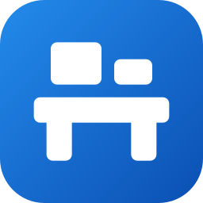
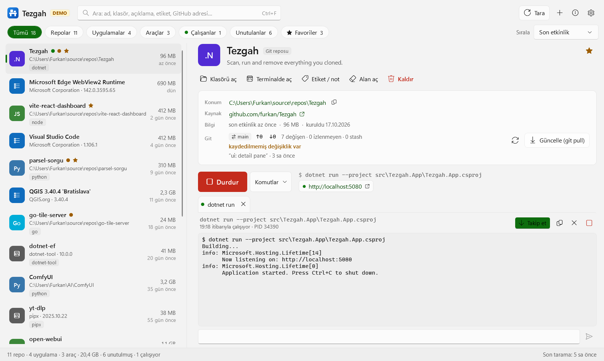
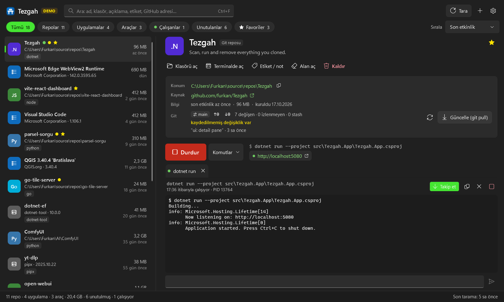
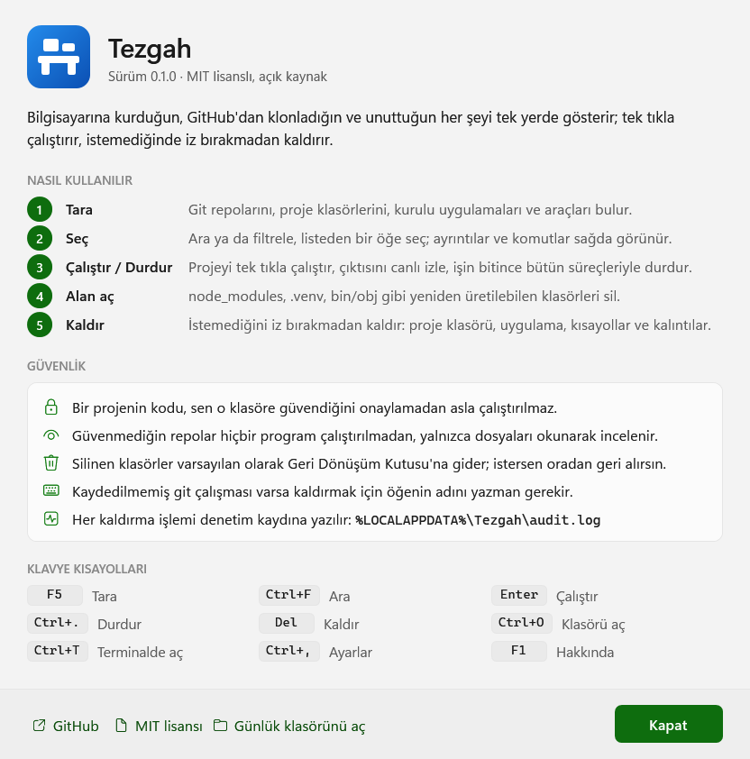
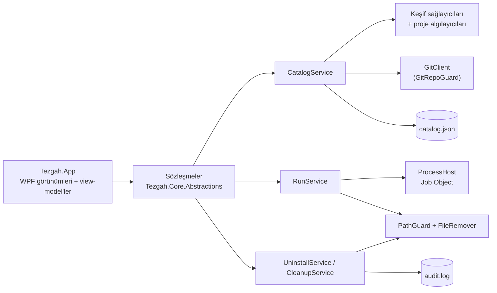

<p align="center">
  
</p>

<h1 align="center">Tezgah</h1>

<p align="center">
  <a href="https://github.com/fneziraslantas-tech/Tezgah/actions/workflows/ci.yml"></a>
  <a href="https://github.com/fneziraslantas-tech/Tezgah/actions/workflows/codeql.yml"></a>
  <a href="LICENSE"></a>
  
  
</p>

<p align="center"><b>Türkçe</b> · <a href="#english">English</a></p>

**Bilgisayarına kurduğun, GitHub'dan klonladığın ve unuttuğun her şeyi tek yerde gösterir; tek tıkla çalıştırır, istemediğinde iz bırakmadan kaldırır.**

Tezgah, geliştiricinin Windows bilgisayarını tarayan açık kaynak bir masaüstü uygulamasıdır: git repoları, proje klasörleri, kurulu uygulamalar ve paket yöneticisi araçları tek listede toplanır. Bir projeyi güvenle çalıştırır, çıktısını canlı gösterir, işin bitince bütün süreç ağacıyla durdurur ve istersen projeyi ya da uygulamayı artıklarıyla birlikte kaldırır.



<details>
<summary>Koyu tema ve "Hakkında" penceresi</summary>





</details>

## Özellikler

- **Tarama** — git repoları ve proje klasörleri (Node, Python, .NET, Rust, Go, Java, Docker, statik web, betikler), kurulu uygulamalar (Windows kayıt defteri) ve paket yöneticisi araçları (pipx, npm -g, cargo, dotnet tool, scoop, go install).
- **Tek tıkla çalıştırma** — algılanan komutlar (`npm run dev`, `dotnet run`, `uv run`, `cargo run`…) ve kendi tanımladığın komutlar; canlı konsol, girdi gönderme, yerel sunucu adreslerini tıklanabilir gösterme.
- **Temiz durdurma** — her çalıştırma bir Job Object içinde: durdurunca ya da Tezgah kapanınca bütün alt süreçler de kapanır.
- **Alan açma** — `node_modules`, `.venv`, `bin/obj` gibi yeniden üretilebilen klasörleri seçerek sil.
- **Tam kaldırma** — proje klasörü, uygulamanın kendi kaldırıcısı, kısayollar, sanal ortamlar ve doğrulanmış artıklar; önce plan gösterilir, sonra onayla uygulanır.
- **Git durumu** — dal, ileri/geri, kaydedilmemiş değişiklikler, stash, push edilmemiş dallar ve worktree'ler.
- **Düzen** — arama, filtreler (repolar, uygulamalar, araçlar, çalışanlar, unutulanlar, favoriler), etiket ve not, klonlama.
- **Türkçe / İngilizce**, açık / koyu tema, klavye ile tam kullanım.

## Kurulum

### Hazır sürüm

[Releases](https://github.com/fneziraslantas-tech/Tezgah/releases) sayfasından `Tezgah-vX.Y.Z-win-x64.zip` dosyasını indir, bir klasöre aç ve `Tezgah.exe`'yi çalıştır. Paket kendi içinde .NET çalışma zamanını taşır; ayrıca kurulum gerekmez. Her zip'in yanında SHA-256 özeti ve GitHub derleme kaynağı kanıtı (build provenance attestation) bulunur:

```powershell
gh attestation verify Tezgah-vX.Y.Z-win-x64.zip --repo fneziraslantas-tech/Tezgah
(Get-FileHash Tezgah-vX.Y.Z-win-x64.zip -Algorithm SHA256).Hash -eq (Get-Content Tezgah-vX.Y.Z-win-x64.zip.sha256).Trim()
```

> **Windows SmartScreen uyarısı:** `Tezgah.exe` kod imzalı değildir; ilk çalıştırmada SmartScreen "Windows bilgisayarınızı korudu" diyebilir. Önce yukarıdaki SHA-256 ve attestation doğrulamasını yap, ardından **Ek bilgi** → **Yine de çalıştır**'a bas.

Sürümler arası değişiklikler: [CHANGELOG.md](CHANGELOG.md).

### Kaynaktan derleme

Gerekenler: Windows 10/11, [.NET 10 SDK](https://dotnet.microsoft.com/download/dotnet/10.0), git.

```powershell
git clone https://github.com/fneziraslantas-tech/Tezgah.git
cd Tezgah
dotnet build
dotnet run --project src/Tezgah.App            # gerçek tarama
dotnet run --project src/Tezgah.App -- --demo  # örnek verilerle, hiçbir şeye dokunmadan
```

Diğer seçenekler: `--demo-empty` (ilk açılış ekranı), `--theme light|dark|system`, `--lang tr|en`.

## Kullanım

1. **Tara** — ilk açılışta "Bilgisayarı tara"ya bas (sonra `F5`). Taranacak klasörler Ayarlar'dan (`Ctrl+,`) değiştirilebilir.
2. **Seç** — ara (`Ctrl+F`), filtrele, listeden bir öğe seç; ayrıntılar sağda.
3. **Çalıştır / Durdur** — `Enter` ile çalıştır, `Ctrl+.` ile durdur. Bir projeyi ilk kez çalıştırırken Tezgah komutu ve kaynağı gösterip güvenip güvenmediğini sorar.
4. **Alan aç** — yeniden üretilebilen klasörleri seçip sil.
5. **Kaldır** — `Del`; plan gösterilir, kaydedilmemiş iş varsa öğenin adını yazman istenir.

Tüm kısayollar ve özet bilgi için `F1` (Hakkında).

## Güvenlik modeli

Taranan her repo **güvenilmeyen girdi** sayılır. Özetle:

- Bir projenin kodu, sen o klasöre güvendiğini onaylamadan çalıştırılmaz; güven klasörün kimliğine bağlıdır, klasör silinip yeniden oluşursa güven düşer.
- Komutlar kabuk olmadan başlatılır; `.cmd/.bat` hedefleri için cmd.exe'ye yalnızca güvenli karakterler geçer (BatBadBut'a karşı).
- Silme işlemleri tek bir yol koruyucusundan (PathGuard) geçer: sistem klasörleri, bağlantılar (junction/symlink), ağ yolları reddedilir; her silmeden hemen önce yeniden denetlenir. Varsayılan hedef Geri Dönüşüm Kutusu'dur.
- Her kaldırma işlemi önce ve sonra `%LOCALAPPDATA%\Tezgah\audit.log` dosyasına yazılır; kayıt yazılamazsa hiçbir şey silinmez.

Tehdit modeli ve açık bildirme yolu: **[SECURITY.md](SECURITY.md)**.

### Güvenlik denetimi

İlk herkese açık sürümden (v0.1.1) önce iki denetim yapıldı:

- **İç çekişmeli denetim** — birden çok ajanla, 3 tur; her bulgu bir regresyon testiyle birlikte düzeltildi.
- **Dış yöntemle denetim** — [cloudflare/security-audit-skill](https://github.com/cloudflare/security-audit-skill), tam denetim, `standard` profil: 0 doğrulanmış bulgu, 8 doğrulama bekleyen sınır hipotezi (hepsi [#5](https://github.com/fneziraslantas-tech/Tezgah/pull/5), [#6](https://github.com/fneziraslantas-tech/Tezgah/pull/6), [#8](https://github.com/fneziraslantas-tech/Tezgah/pull/8) ve [#9](https://github.com/fneziraslantas-tech/Tezgah/pull/9) ile düzeltildi), 2 reddedilen kayıt. Hedef kod yalıtılmış ortam olmadığı için çalıştırılamadı; "0 doğrulanmış" bu çalıştırmanın sonucudur, açık olmadığının kanıtı değildir.

Yöntem, kapsam, sınırlar ve bulgu-PR eşlemesi: [docs/security-audit-2026-11.md](docs/security-audit-2026-11.md).

## Mimari

```
src/
  Tezgah.Core/            UI'dan bağımsız çekirdek (net10.0-windows)
    Model/                CatalogItem, RunProfile, UninstallPlan… (değişmez kayıtlar)
    Abstractions/         sözleşmeler: ICatalogService, IRunService, IUninstallService, IGitClient, IPathGuard…
    Discovery/            dosya sistemi, kayıt defteri, paket yöneticileri; proje algılayıcıları; git istemcisi
    Catalog/              katalog servisi + JSON deposu (%LOCALAPPDATA%\Tezgah\catalog.json)
    Execution/            süreç başlatma, Job Object, cmd argüman koruması, ShellOpener
    Safety/               PathGuard, FileRemover (Geri Dönüşüm Kutusu / kalıcı silme)
    Uninstall/            kaldırma planı ve uygulaması, alan açma, denetim kaydı
    Interop/              Win32 P/Invoke
  Tezgah.App/             WPF (MVVM, CommunityToolkit.Mvvm), Fluent tema, demo servisleri
tests/
  Tezgah.Core.Tests/      birim + gerçek çekirdek üzerinde uçtan uca testler
  Tezgah.App.Tests/       view-model, kaynak, diyalog çizimi ve bileşim testleri
```

Katmanlar yalnızca `Abstractions` içindeki sözleşmeler üzerinden konuşur. Çekirdek kendini `services.AddTezgahCore()` ile kaydeder (her katman kendi kısmi dosyasında); `App.ConfigureServices` bunun üstüne WPF servislerini ekler ve `--demo` modunda çekirdek servisleri sahte (demo) karşılıklarıyla değiştirir. View-model'ler hiçbir WPF tipine dokunmaz; pencereler, iletişim kutuları ve kabuk işlemleri `IDialogService`, `IShellService`, `IUiDispatcher` arkasındadır.



## Testler

```powershell
dotnet test
```

~760 test: ayrıştırıcılar, PathGuard ve silme kuralları, cmd argüman koruması, git sertleştirmesi, katalog birleştirme, view-model'ler, kaynak anahtarı eşliği, her diyaloğun gerçek kaynaklarla çizimi ve gerçek çekirdek üzerinde geçici klasörlerde koşan uçtan uca senaryolar (tarama → güven → çalıştır → durdur → kaldır). CI her push ve PR'da Release derlemesi (uyarılar hata sayılır, analizörler açık), testler, NuGet açık denetimi, gitleaks ve CodeQL çalıştırır.

## Katkı

Hata bildirimi ve önerilere açığız. Kısa yol: issue aç, küçük ve odaklı PR gönder, `dotnet build` ve `dotnet test` yeşil olsun. Ayrıntılar: [CONTRIBUTING.md](CONTRIBUTING.md). Güvenlik açıklarını issue olarak değil, [SECURITY.md](SECURITY.md)'deki yoldan bildir.

## Lisans

[MIT](LICENSE) © 2026 Tezgah katkıcıları

---

<a id="english"></a>

## English

**Shows everything you installed, cloned from GitHub and forgot about in one place; runs it with one click and removes it without a trace when you no longer want it.**

Tezgah ("workbench" in Turkish) is an open-source Windows desktop app that scans a developer's PC for git repos, project folders, installed apps and package-manager tools and puts them in one list. It runs a project safely, streams its output, stops it with its whole process tree, and removes a project or an app together with its leftovers when you are done.

### Features

- **Scan** — git repos and project folders (Node, Python, .NET, Rust, Go, Java, Docker, static web, scripts), installed apps (Windows registry) and package-manager tools (pipx, npm -g, cargo, dotnet tool, scoop, go install).
- **One-click run** — detected commands (`npm run dev`, `dotnet run`, `uv run`, `cargo run`…) plus your own; live console, stdin, clickable local server URLs.
- **Clean stop** — every run lives in a Job Object, so stopping it (or closing Tezgah) ends all child processes.
- **Free space** — delete regenerable folders such as `node_modules`, `.venv`, `bin/obj`.
- **Full removal** — project folder, the app's own uninstaller, shortcuts, virtualenvs and verified leftovers; you see the plan first and confirm it.
- **Git status** — branch, ahead/behind, unsaved changes, stashes, unpushed branches and worktrees.
- **Organise** — search, filters (repos, apps, tools, running, forgotten, favourites), tags and notes, clone.
- **Turkish / English**, light / dark theme, fully keyboard-driven.

### Install

**Release:** download `Tezgah-vX.Y.Z-win-x64.zip` from [Releases](https://github.com/fneziraslantas-tech/Tezgah/releases), unzip, run `Tezgah.exe` (self-contained, no .NET install needed). Each zip ships with a SHA-256 file and a GitHub build provenance attestation (`gh attestation verify <zip> --repo fneziraslantas-tech/Tezgah`).

> **Windows SmartScreen:** `Tezgah.exe` is not code-signed, so SmartScreen may show "Windows protected your PC" on first run. Verify the SHA-256 (`(Get-FileHash <zip> -Algorithm SHA256).Hash` against the `.sha256` file) and the attestation first, then choose **More info** → **Run anyway**.

Changes between releases: [CHANGELOG.md](CHANGELOG.md).

**From source:** Windows 10/11, [.NET 10 SDK](https://dotnet.microsoft.com/download/dotnet/10.0) and git.

```powershell
git clone https://github.com/fneziraslantas-tech/Tezgah.git
cd Tezgah
dotnet build
dotnet run --project src/Tezgah.App            # real scan
dotnet run --project src/Tezgah.App -- --demo  # sample data, touches nothing
```

Other switches: `--demo-empty` (first-launch screen), `--theme light|dark|system`, `--lang tr|en`.

### Usage

1. **Scan** — press "Scan this computer" on first launch (`F5` afterwards). Scan roots are in Settings (`Ctrl+,`).
2. **Select** — search (`Ctrl+F`), filter, pick an item; details are on the right.
3. **Run / Stop** — `Enter` runs, `Ctrl+.` stops. The first run of a project shows the command and its origin and asks whether you trust it.
4. **Free space** — tick regenerable folders and delete them.
5. **Remove** — `Del`; the plan is shown, and unsaved work requires typing the item's name.

Press `F1` (About) for all shortcuts and a short overview.

### Security model

Every scanned repo is treated as **untrusted input**: its code never runs until you trust the folder (trust is bound to the folder's identity); commands start without a shell and batch targets only receive cmd-inert characters (BatBadBut); every deletion goes through one path guard (system folders, links and network paths refused, re-checked right before deleting) and goes to the Recycle Bin by default; every removal is written to `%LOCALAPPDATA%\Tezgah\audit.log` before and after — no audit record, no deletion. Threat model and how to report a vulnerability: **[SECURITY.md](SECURITY.md)**.

### Security audit

Two audits ran before the first public release (v0.1.1):

- **Internal adversarial audit** — multi-agent, 3 rounds; every finding was fixed together with a regression test.
- **External-method audit** — [cloudflare/security-audit-skill](https://github.com/cloudflare/security-audit-skill), full audit, `standard` profile: 0 confirmed findings, 8 boundary hypotheses needing validation (all fixed in [#5](https://github.com/fneziraslantas-tech/Tezgah/pull/5), [#6](https://github.com/fneziraslantas-tech/Tezgah/pull/6), [#8](https://github.com/fneziraslantas-tech/Tezgah/pull/8) and [#9](https://github.com/fneziraslantas-tech/Tezgah/pull/9)), 2 rejected records. Target code could not be executed because no isolated sandbox was available, so "0 confirmed" is a property of that run, not proof that no vulnerability exists.

Method, scope, limits and the finding-to-PR mapping: [docs/security-audit-2026-11.md](docs/security-audit-2026-11.md).

### Architecture

`Tezgah.Core` (UI-independent: Model, Abstractions, Discovery, Catalog, Execution, Safety, Uninstall, Interop) and `Tezgah.App` (WPF, MVVM with CommunityToolkit.Mvvm, Fluent theme). Layers only talk through the contracts in `Abstractions`; the core registers itself with `services.AddTezgahCore()` (one partial file per layer), `App.ConfigureServices` adds the WPF services and swaps in demo fakes for `--demo`. View-models never touch WPF types: windows, dialogs and shell actions sit behind `IDialogService`, `IShellService` and `IUiDispatcher`. See the diagram above.

### Tests

`dotnet test` runs ~760 tests: parsers, PathGuard and deletion rules, cmd argument guard, git hardening, catalog merging, view-models, resource key parity, rendering of every dialog with the real resources, and end-to-end scenarios over the real composed core in temporary folders (scan → trust → run → stop → remove). CI runs a Release build (warnings as errors, analyzers on), the tests, NuGet vulnerability audit, gitleaks and CodeQL on every push and PR.

### Contributing

Issues and small, focused pull requests are welcome; keep `dotnet build` and `dotnet test` green. See [CONTRIBUTING.md](CONTRIBUTING.md). Report vulnerabilities privately as described in [SECURITY.md](SECURITY.md), not as issues.

### License

[MIT](LICENSE) © 2026 Tezgah contributors
